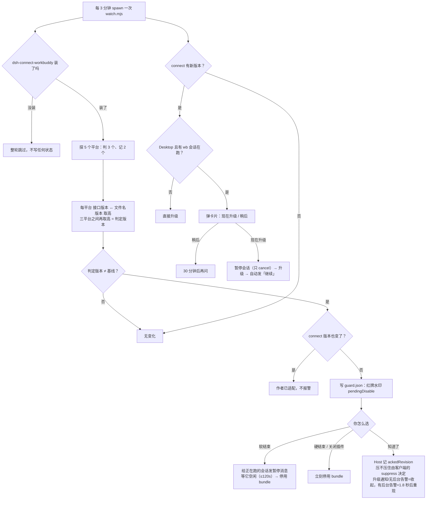

# dsh-workbuddy 账号呵护

> `dsh-workbuddy-account-care` —— [`dsh-connect-workbuddy`](https://github.com/dingminhua/dsh-connect-workbuddy) 的配套刹车片。
>
> 它自己**不提供任何模型能力、不装第二个定时器、不调用任何模型**。只做一件事：
> 盯着 WorkBuddy 官方发的版本号，一旦那个插件跑在「它没适配过」的客户端上，
> 就在你眼前挂一条提示，并让你决定要不要停用它。


---

## 前置条件

**必须先装 `dsh-connect-workbuddy`。** 本插件没有自己的 provider、模型、界面入口，
全部动作都围绕「那个插件现在安不安全」。

```bash
dsh plugin --profile web add dsh-connect-workbuddy
dsh plugin --profile web add dsh-workbuddy-account-care   # 然后重启 DSH
```

目标插件不在 `node_modules` 里时，本插件**整轮静默跳过**：不停用、不升级、
不挂水印、不碰 profile、连基线都不写，只留一行日志说明为什么跳过。

## 它做什么

| 遇到的情况 | 它干什么 |
|---|---|
| WorkBuddy 版本 ≠ 基线，且 `dsh-connect-workbuddy` 没动过 | 红色水印（+ 桌面通知），等你选「软结束 / 硬结束 / 知道了」。**默认不自动停用** |
| WorkBuddy 版本 ≠ 基线，但 `dsh-connect-workbuddy` 也换过版本 | 视为作者已适配，只记一条日志，不报警 |
| npm 上 `dsh-connect-workbuddy` 有新版 | 自动升级，成功后挂水印（要重启就说要重启，热生效就说已生效） |
| 同上，但在 Desktop 且有 wb 会话在跑 | 先弹「现在升级 / 稍后」，点了才升：暂停会话 → 升级 → 自动让它们继续 |
| 第一次跑 / 判定平台集合变过 | 只落基线，不报警 |
| 全都对得上 | 静默，只写一行日志 |



## 版本号从哪来

唯一外部数据源，一个 GET：

```
https://www.workbuddy.cn/v2/update?platform=workbuddy-darwin-x64
```

每轮探 5 个平台：

| 角色 | platform |
|---|---|
| **判定** | `workbuddy-darwin-x64`、`workbuddy-darwin-arm64`、`workbuddy-win32-x64-user` |
| 只记录 | `workbuddy-linux-x64-deb`、`workbuddy-linux-arm64-deb`（实测整线滞后一个大版本段，算进「取高」只会制造噪声） |

每个平台取**两路**版本，取高者：

1. 响应里的 `productVersion`（没有则退回 `version`）；
2. `url` 的**文件名**里的版本号 —— `…WorkBuddy-darwin-x64-5.9.3.42398134-d4692421.zip` → `5.9.3.42398134`。

然后三个判定平台之间再取高，得到**判定版本**，与 `state.json` 的 `baseline.version`
做**字符串比较**（不比大小：官方回退到旧版本同样算「变了」，因为客户端被换成旧构建
一样可能让私有接口失效）。

> 只解析，不下载，也不对链接发 HEAD —— 为了一句「没看错」去拖 180MB 不合理。
> 两路不一致时按高的算（发布不同步是常态），低的那路记一条 `warn`。

**为什么「connect 变了」算适配**：基线里记的是「这个 connect 版本见过这个 WB 版本」
这么一对。如果 connect 现在的版本与基线里的不同，说明作者发过新版、你也更新过了，
那就轮不到本插件替你担心。反过来说，**WB 发了新版而作者还没适配**时 connect 仍然是
npm 上的 latest —— 这恰恰是唯一需要报警的场景，所以不能拿「已是最新」当豁免。

## 界面与按钮

红色 = WB 版本不一致，等你处理；橙色 = 插件自身升级后需要重启；蓝色 = 已热生效：


卡片挂在 `shell.overlay`，切会话、滚页面都不会带走；容器 `pointer-events: none`
不吃点击；颜色跟随主题令牌，`prefers-reduced-motion` 时动画全关。

| 按钮 | 效果 |
|---|---|
| **软结束** | 给正在用 WorkBuddy 的会话发一条暂停消息，等它们停下来（最多 120 秒）再停用插件 |
| **硬结束** / **关闭插件** | 立刻停用插件。两者效果相同，只是文案不同 |
| **现在升级** / **稍后** | 只在 Desktop 且有会话在跑时出现。见「Desktop 上的升级会先问你」|
| **知道了** | 分两种语义（见下） |

「知道了」按水印的形态分两种，这不是实现细节，而是需求里的两条：

- **升级通知**（要重启的 / 已热生效的）= 需求 2「点击之后直接消失」。Host 记下
  `ackedRevision`，这条 revision 不再下发，刷新、重启都不再出现。
- **危险告警**（「还用，你的账号是批发的吗？」及其处理后的收尾水印）= 需求 3 的
  **强提醒**。Host 照常记下 `ackedRevision`，但**继续下发**：卡片先收起，1.8 秒后
  重新浮现，直到你真的选了软结束 / 硬结束，或者切走不用 WorkBuddy 了。反复弹出
  是刻意的。

  但有一种例外：告警是「等你决定」、而且**没有**后台 wb 会话在跑（界面上只有
  「关闭插件 / 知道了」两个按钮）时，需求要的是「点了之后消失」——没有任何正在
  跑的东西需要提醒，看过就够了。这种收起的结论由**客户端**判断（只有它知道有
  没有后台会话），随 ack 一起带给 Host，Host 照办并落盘成 `ackSuppress`。

按钮组合由客户端实时算（宿主只在内容变化时重算，会卡住）：有后台 wb 会话在跑
→ 软结束 / 硬结束 / 知道了；只有前台选中、没有后台任务 → 关闭插件 / 知道了；
插件已经被关掉 → 只剩知道了。

「停用」= 把 `dsh-connect-workbuddy` 从 profile 的 `dsh.profile.bundles` 里摘掉
（`dependencies` 保留，随时能装回来）。改之前会备份 `package.json`，写完回读校验，
对不上就回滚——**没停成功水印就不会消失**，不会出现「提示没了但插件还在跑」。

升级成功后也会挂水印（要重启是橙色、热生效是蓝色），因为插件在后台动过你的环境，
这件事该留痕迹。若那时还有一条没处理的 WB 告警，它会被这条覆盖。

### Desktop 上的升级会先问你

DSH Desktop 的升级走宿主 `pluginManager.updateBundle()`，源码里是
**先 `removeBundle` 再 `installBundle`** 两步。中间那段时间
`node_modules/dsh-connect-workbuddy` 在磁盘上真的不存在——正在跑的 wb 会话
如果那一刻发请求，就是一次注定失败的调用，任务直接断掉。

npm / `dsh plugin add` 那条路是「先装新版本、再切目录」，没有这个空窗。

所以 Desktop 上、且有 wb 会话在跑时，会先弹一张卡片：

| 按钮 | 效果 |
|---|---|
| **现在升级** | 暂停正在跑的会话 → 升级 → 装好后自动发「继续」让它们接着干 |
| **稍后** | 这次不升，30 分钟后**再问一次**（推迟 ≠ 取消） |

三个边界：

- **没有会话在跑** → 不弹窗，直接静默升级（没东西会被打断）
- **非 Desktop** → 不弹窗也不暂停（没有空窗）
- **暂停复用「软结束」那套** —— 先给会话插一条说明（「要升级了，先存进度」），
  等它停下来，再装包。不是闷声 `cancel`：那样会话只会看到一轮莫名中止，
  再接一句没头没尾的「请继续」

「现在升级」的批准绑在这条升级指令的 revision 上：换一个目标版本就要重新问，
不会把上次点的同意当成这次也同意。

## 什么时候跑

| 时机 | 行为 |
|---|---|
| DSH 启动、bundle 加载后 | `startupDelayMs`（默认 3 秒）后跑第一次——不是等一个 `intervalMinutes`，否则刚启动的头三分钟里它是瞎的 |
| 运行中装 / 卸 / 改启用状态 | 收到 `plugin-manager/changed` 后 1 秒补跑 |
| 目标插件一时读不到 | 15 秒后重试，最多 4 次（避免把「还在收敛」误判成没装） |
| 其余 | 每 `intervalMinutes`（默认 3 分钟）一次 |

**只有一条定时链，全在 DSH 进程内**，不需要 systemd / cron / launchd，也不用 DSH 的
「自动化任务」（那个每触发一次就是一次完整的模型回合，一天一千多个回合只为了说
「无变化」）。代价是：**DSH 不开就不检查**——这在语义上够用，DSH 没跑就不会有任何
请求发出去。

从「脚本发现变化」到「你看见水印」分三段：脚本每 3 分钟一轮 → 宿主每 **2 秒**读
`guard.json`（脚本退出时还会立刻同步一次）→ 浏览器每 **5 秒**拉一次 `/state`
（只在标签页可见时）。第一段刻意不动：后台探测慢两分钟没人有感觉，真正会被察觉的是
后两段「已经知道了却还没画出来」。

## 命令

```bash
npx dsh-workbuddy-account-care status    # 基线 / 判定 / 插件版本 / 水印 / 检查次数
npx dsh-workbuddy-account-care where     # 各条路径 + 定时来源
npx dsh-workbuddy-account-care check     # 立刻跑一次检查
```

`check` 的参数原样透传给检查脚本：

```bash
npx dsh-workbuddy-account-care check --check              # 只检查，绝不改 profile
npx dsh-workbuddy-account-care check --dry-run            # 演练，不落盘
npx dsh-workbuddy-account-care check --enable             # 把停用的插件加回来
npx dsh-workbuddy-account-care check --clear-watermark    # 只清界面水印
npx dsh-workbuddy-account-care check --no-upgrade         # 跳过自动升级
npx dsh-workbuddy-account-care check --status             # 机器可读 JSON
npx dsh-workbuddy-account-care check --simulate-version 9.9.9.99999   # 演练一次「WB 更新了」
```

> `--simulate-version` 不推进基线，但**会**照常写水印——演练完记得
> `check --clear-watermark`。

## 配置

在 profile 的 `cordis.patch.yml` 里覆盖，改完重启 DSH：

```yaml
- id: dsh-workbuddy-account-care
  name: dsh-workbuddy-account-care
  config:
    intervalMinutes: 3      # 内置定时间隔
    selfSchedule: true      # false = 关掉内置定时，完全依赖外部触发
    startupDelayMs: 3000    # 加载后多久跑第一次；0 = 立刻
    notify: true            # false = 不弹桌面通知（Windows 没有原生通道，只记日志）
    pollMs: 2000            # 宿主读指令文件的间隔
    profile: web            # 目标 profile（建议显式写，见下）
```

**建议显式写 `profile`**：脚本要去某个 profile 里找 `dsh-connect-workbuddy`。取值顺序是
`--profile-dir` → `--profile` / `config.profile` → 环境变量 `DSH_PROFILE` → 按
`desktop`、`web` 顺序串行探测（第一个真装了目标插件的胜出）。**DSH Desktop 从托盘启动时
不带 `DSH_PROFILE`**，于是可能查错目录、报「未安装」再整轮静默——看起来像没工作。
排障时先看 `check --status` 里的 `profileResolution.source`，`detected-miss` 就是它。

策略文件 `~/.dsh/workbuddy-update-watch/config.json`（改完不必重启）：

```json
{ "autoDisable": false }
```

| 键 | 含义 |
|---|---|
| `autoDisable` | `false`（**默认**）= 只挂提示，由你在界面上选；`true` = 检测到就当场停用 |
| `disableOn` | 旧键。`"never"` 仍有效（命中只挂提示、永不改 profile），其它值等同于默认 |
| `profile` | 目标 profile 名，等价于 `config.profile` |

环境变量：`DSH_HOME`（默认 `~/.dsh`）、`DSH_PROFILE`、`WB_GUARD_FILE`（覆盖指令文件路径）、
`WORKBUDDY_WATCH_PLATFORM`、`WORKBUDDY_WATCH_UPSTREAM`（自建镜像时覆盖版本接口）、
`WORKBUDDY_WATCH_DISABLE_ON_UPSTREAM`。

状态文件都在 `$DSH_HOME/workbuddy-update-watch/`：`state.json`（基线 / 判定 / 事件去重）、
`guard.json`（给宿主的指令：水印 + 软结束 + 升级）、`watch.log`、`config.json`、
`run.lock`（多执行器互斥）、`package.json.bak-*`（改 profile 前的备份）。

## 许可

MIT
