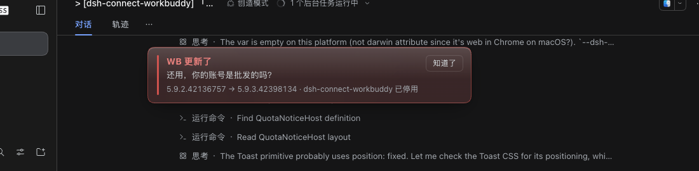
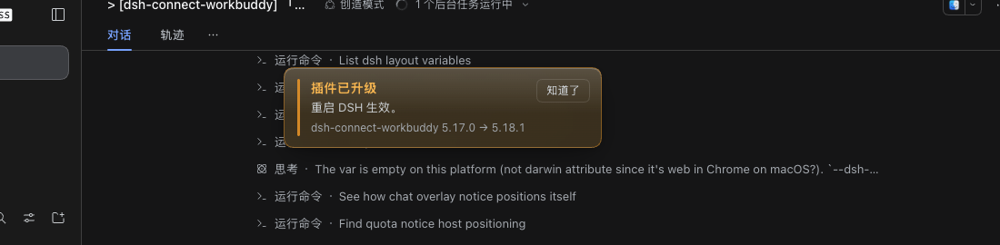

# dsh-workbuddy-guard

> **本仓库是 [`dsh-connect-workbuddy`](https://github.com/dingminhua/dsh-connect-workbuddy) 的配套辅助插件——它不提供任何模型能力，只为那个插件踩刹车。**
>
> **安装本插件之前，请先安装 `dsh-connect-workbuddy`。** 没有它，本插件不产生任何效果。
>
> 本机 WorkBuddy 客户端一旦升级，立刻停用那个插件；它自己在 npm 上有新版，就自动升级并提示重启。
> 全程零模型调用，DSH 不启动就什么都不做。



---

## ⚠️ 前置条件：先装 `dsh-connect-workbuddy`

**本插件是 `dsh-connect-workbuddy` 的守卫，不是它的替代品，也不能单独工作。**
它没有自己的模型、没有自己的 provider、没有自己的界面入口；它的全部动作都围绕
「那个插件现在安不安全」展开。所以你**必须先装好 `dsh-connect-workbuddy`，再来装本插件**。

请先按这里的说明安装好：

👉 **<https://github.com/dingminhua/dsh-connect-workbuddy>**

```bash
# 1) 先装 dsh-connect-workbuddy（按它自己的 README）
dsh plugin --profile web add dsh-connect-workbuddy

# 2) 确认它已被选中、且模型选择器里能看到 WorkBuddy 的模型
#    然后才装本守卫
dsh plugin --profile web add dsh-workbuddy-guard
```

**没装就完全不动。** 守卫每次检查前先确认 `dsh-connect-workbuddy` 真的在
`node_modules` 里；不在就整轮跳过——不停用、不升级、不挂水印、不碰 profile，
连基线都不写（只留一行日志说明为什么跳过）。

这条不是礼貌，是必需的：本守卫的一项动作是「自动升级
`dsh-connect-workbuddy`」。在没有装它的机器上，那个动作会变成**凭空安装一个
你没要求过的插件**。所以未安装时它必须彻底安静。

## 它解决什么

`dsh-connect-workbuddy` 靠**本机 WorkBuddy 客户端的私有接口**工作（伪装客户端、
复用本机登录态），上游随时可能收紧。这个守卫把风险面收窄成两条规则：

| 事件 | 动作 |
|---|---|
| **本机 WorkBuddy 被升级 / 重装** | 停用 `dsh-connect-workbuddy` + 红色水印 + 软结束正在用它的会话 + 桌面通知 |
| **`dsh-connect-workbuddy` 在 npm 上有新版** | 自动升级 + 橙色水印提示重启 DSH |
| 上游发布新版本（本机没动） | 只记日志，**不动配置** |
| 什么都没有 | 静默，只写一行日志 |

判断依据是**本机安装的版本**，不是上游发布：上游发版但你没升级时，那个插件
仍然能用，没必要提前停掉。

升级后想恢复：

```bash
npx dsh-workbuddy-guard check --enable
```

## 安装

```bash
# 从目录/压缩包
dsh plugin --profile web add /path/to/dsh-workbuddy-guard

# 然后重启 DSH，或刷新 Web 页面
```

**没有定时器要装。** 插件自带定时（每 3 分钟），不需要 systemd、cron、launchd，
也不需要 DSH 的「自动化任务」。

装完之后可以这样确认它在工作：

```bash
npx dsh-workbuddy-guard status    # 守卫状态：目标插件版本 / 启用与否 / 水印 / 检查次数
npx dsh-workbuddy-guard where     # 各条路径 + 当前定时来源
```

`status` 里 `plugin on` 指的是 **`dsh-connect-workbuddy`** 是否仍被选中——
本守卫自己始终是启用的，它不守卫自己。

> DSH 的「自动化任务」是**按计划给会话发一条消息**——每触发一次就是一次完整
> 的模型回合。3 分钟一次等于一天 480 个回合，去换 480 句「无变化」。这件事
> 没有任何需要模型判断的地方，所以定时器放在进程里，不经过模型。

## 界面

**本机 WorkBuddy 升级后**（红色，同时会停用插件并软结束会话）：


**插件自身升级后**（橙色，提示重启）：



- 水印挂在 `shell.overlay`（frame 级浮层），切会话、滚页面都不会带走。
- **玻璃感浮层**：半透明底色 + `backdrop-filter` 模糊 + 极细描边 + 顶部高光，
  像浮在页面之上的一层玻璃，而不是一块实心色条；入场 340ms 从上方淡入浮起，
  关闭 180ms 淡出下沉。
- 容器 `pointer-events: none`，不吃点击，不挡对话。
- 「知道了」只对**同一条**水印有效（按 revision 记在 localStorage）；版本再变会重新出现。
- 颜色跟随主题令牌（`--dsw-alias-*`），亮/暗自动适配；`prefers-reduced-motion` 时动画全关。

### 水印什么时候消失（不是浏览器缓存）

水印的值**持久化在 `guard.json` 里**，Host 每次启动都会重新读它再推给浏览器。
所以「重启后提示还在」从来不是缓存没清，而是这条水印本来就该留着。两类水印的生命周期不同：

| 水印 | 什么时候消失 |
|---|---|
| 🔴 `WB 更新了`（危险，插件已停用） | **一直留着**，直到你 `check --enable` 或 `check --clear-watermark`。它必须活过重启——重启不等于你知道了。 |
| 🟠 `插件已升级，重启生效` | **重启后自动消失**。脚本写它时带 `untilRestart: true` 与 `at`；插件启动后第一次轮询发现 `at` 早于自己的启动时刻，就把 `guard.json` 里的水印清成 `null` 并抬高 revision，浏览器半下一次轮询（≤30 秒）就会把它撤掉。 |

清除优先于发布：清除串在第一次发布之前，所以不会出现「先闪出旧卡片再消失」。
另外切回标签页时浏览器半会立刻补拉一次状态，不用等 30 秒的轮询周期。

想立刻手动清掉当前那条：`npx dsh-workbuddy-guard check --clear-watermark`。

## 工作方式

只有一条定时链，全部在 DSH 进程内：

```
dsh-workbuddy-guard（Host 半）
  ├─ 每 3 分钟 spawn 一次 scripts/watch.mjs
  │     ├─ 前置检查：dsh-connect-workbuddy 装了吗？没装 → 直接退出
  │     ├─ 读本机 WorkBuddy 版本（dpkg / app.asar / 内置 build id / git commit）
  │     ├─ 读 npm 上 dsh-connect-workbuddy 的 latest
  │     ├─ 本机版本变了 → 从 profile 的 bundles 里摘掉它（保留依赖）
  │     │                  并写 guard.json（水印 + 软结束指令）
  │     └─ npm 有新版本 → dsh plugin add 升级它，写「重启生效」水印
  │
  └─ 每 15 秒读一次 guard.json
        ├─ 水印 → 经 HTTP 端点给浏览器半，由它在 shell.overlay 里画
        └─ 软结束指令 → cancel 正在跑的轮次 + followup 一条「暂停执行，等待重启 agent 工具」
```

水印的生命周期分在两半，各管一段：

```
scripts/watch.mjs                  index.js（Host 半）                 client.js（浏览器半）
  ├─ 写 watermark{at}              ├─ 首次 poll 先判过期：             ├─ 每 30 秒 / 切回标签页拉一次
  ├─ 危险水印：不带 untilRestart   │   untilRestart 且 at < 启动时刻    ├─ 玻璃卡在 shell.overlay 里淡入
  └─ 升级水印：带 untilRestart     │   → 清成 null、revision +1        └─ 「知道了」按 revision 记 localStorage
                                   └─ 之后每 15 秒读 guard.json
```

**为什么停用由脚本做而不是插件自己做**：派生出去的是独立进程，即使插件因为
别的原因半死不活，它照样能把危险的 bundle 关掉。判断只有一个执行者（脚本），
呈现只有一个执行者（插件），不重叠。

## 软结束会话

只针对**正在跑**（`status === 'running'`）且**确实在用 WorkBuddy**（投影
`modelSelection`、`agent.options`、日志里最后一条 assistant 消息，三路任一命中）
的会话：

1. `agent.cancel({ kind: 'hook' }, { keepInbox: true })` —— 中止当前轮，保留收件箱；
2. `agent.followup(...)` —— 排一条「暂停执行，等待重启 agent 工具。本机 provider 已更新，本条消息由监控插件自动发送，不是你的输入。」

先 cancel 再 followup 是有意的：那条说明才会成为下一轮的唯一输入，而不是被
这次中止一起丢掉。已经软结束过的会话不会重复插入（收件箱里有
「本条消息由监控插件自动发送」这句话就跳过），空闲会话不动。

## 命令

```bash
npx dsh-workbuddy-guard status    # 守卫状态：版本、启用与否、水印、检查次数
npx dsh-workbuddy-guard where     # 各条路径 + 当前定时来源
npx dsh-workbuddy-guard check     # 立刻跑一次检查
```

`check` 可透传：

```bash
npx dsh-workbuddy-guard check --dry-run            # 演练，不落盘
npx dsh-workbuddy-guard check --check              # 只检查，绝不改 profile
npx dsh-workbuddy-guard check --enable             # 恢复被停用的插件
npx dsh-workbuddy-guard check --clear-watermark    # 只清界面水印
npx dsh-workbuddy-guard check --no-upgrade         # 跳过自动升级
npx dsh-workbuddy-guard check --status             # 机器可读 JSON
```

也可以直接跑脚本：

```bash
node node_modules/dsh-workbuddy-guard/scripts/watch.mjs
```

## 配置

在 profile 的 `cordis.patch.yml` 里覆盖，改完重启 DSH：

```yaml
- id: dsh-workbuddy-guard
  name: dsh-workbuddy-guard
  config:
    intervalMinutes: 3      # 内置定时间隔，分钟
    selfSchedule: true      # false = 关掉内置定时（此时不会有任何自动检查）
    notify: true            # false = 不弹桌面通知
    pollMs: 15000           # 读指令文件的轮询间隔
```

策略文件 `~/.dsh/workbuddy-update-watch/config.json`：

```json
{ "disableOn": "local" }
```

| 值 | 含义 |
|---|---|
| `local` | **默认**。只有本机 WorkBuddy 真的升级了才停用 |
| `upstream` | 上游一发新版就停用（更保守） |
| `either` | 任一发生即停用 |
| `never` | 只记录和通知，永不自动改 profile |

## 环境变量

| 变量 | 默认 | 说明 |
|---|---|---|
| `DSH_HOME` | `~/.dsh` | DSH 主目录 |
| `DSH_PROFILE` | `web` | 目标 profile |
| `WORKBUDDY_APP_DIR` | 按平台猜 | WorkBuddy 安装根（Linux `/opt/WorkBuddy`，macOS `/Applications/WorkBuddy.app/Contents`，Windows `%LOCALAPPDATA%\Programs\WorkBuddy\resources`） |
| `WORKBUDDY_WATCH_PLATFORM` | 按平台猜 | 上游版本接口的 platform 标识 |
| `WORKBUDDY_WATCH_UPSTREAM` | 官网 `/v2/update` | 覆盖上游版本接口 |
| `WORKBUDDY_WATCH_DISABLE_ON_UPSTREAM` | 未设 | 设为 `1` 等价 `disableOn: "either"` |

## 状态文件

都在 `$DSH_HOME/workbuddy-update-watch/`：

| 文件 | 内容 |
|---|---|
| `state.json` | 基线指纹、已见版本、事件去重 |
| `guard.json` | 给插件的指令（水印 + 软结束），插件回写 `handled` |
| `watch.log` | 每次检查一行 |
| `config.json` | 策略（可选） |
| `run.lock` | 多执行器互斥（手动跑与定时跑撞车时用） |
| `package.json.bak-*` | 每次改 profile 前的备份 |

## 已知边界

- **DSH 不在跑就不检查。** 刻意如此：没有 DSH 进程，就没有任何请求会发出去，
  那时检查没有意义。
- **只认「本机安装变了」**。如果本机升级发生在 DSH 未运行期间，下次启动后的
  第一次检查仍然会发现（基线是持久化的）。
- **降级也会触发**。本机版本变旧同样算「安装变了」——刻意的，降级一样可能
  打破插件假设。
- **Host 插件改代码要重启 DSH**：HMR 不会重新加载已装载的 Host 模块。
  浏览器半（`client.js`）不一样：`client-hmr` 会盯着它的构建产物，文件一变
  页面自己就重新加载。
- **水印文案写死在脚本里**（`updateWatermark()`），改文案改脚本即可。
- **过期判定依据时间戳**：`untilRestart` 水印靠 `at` 与本进程启动时刻比较。
  系统时钟被往回调时，该过期的那条可能多留一会儿；判不出来时一律不清，
  宁可多留一条提示，也不误删危险水印。
- **升级不会自动重启 DSH**：升级一路只挂「重启生效」水印，不动用户进程。
- **停用只是取消选中**：`dependencies` 保留，`--enable` 一条命令恢复。

## 许可

MIT
