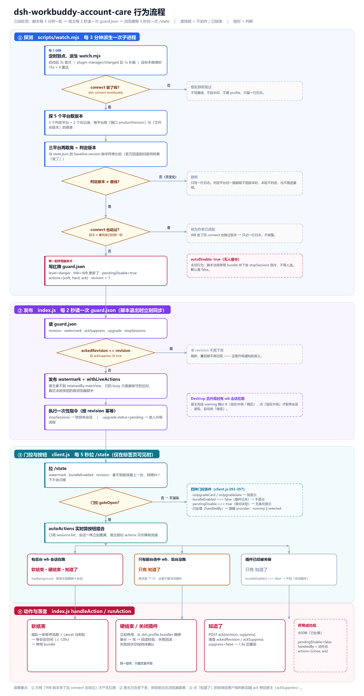
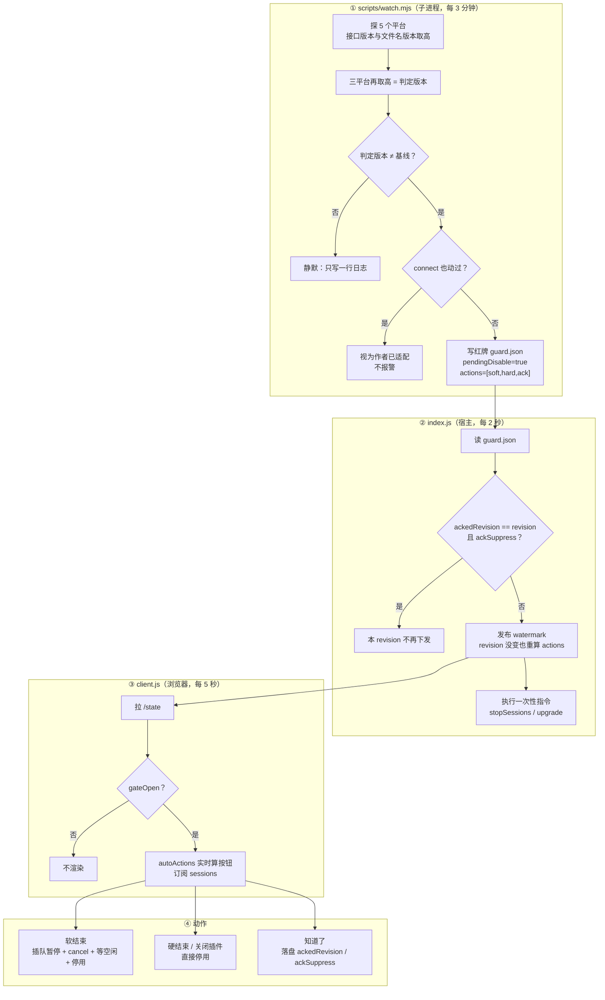
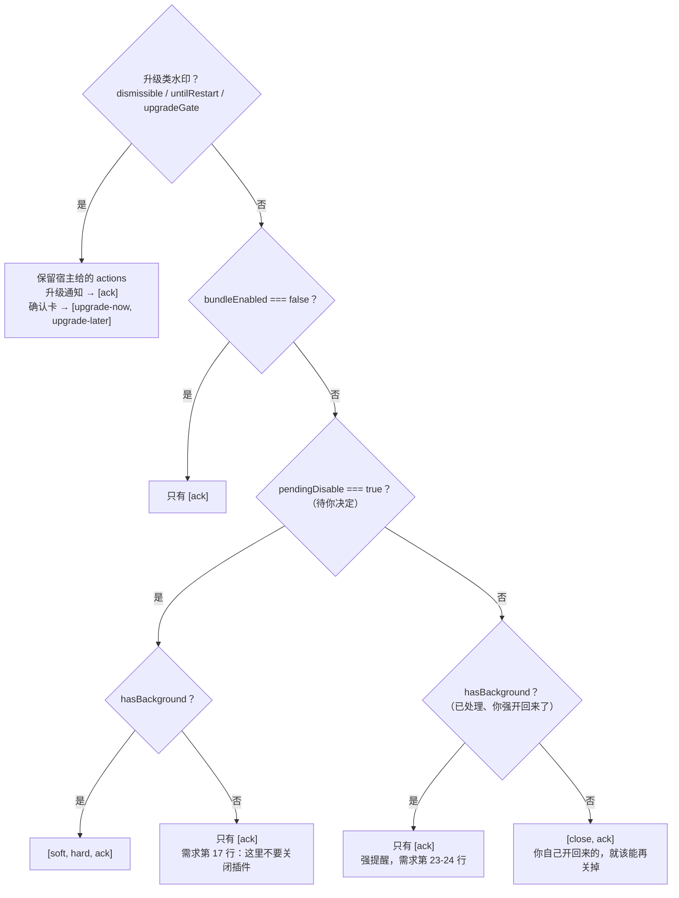

# 行为流程图与「按钮组合」分析

> 对应版本：`dsh-workbuddy-account-care@0.0.10`（`5c74f8c`）
> 图由 `docs/diagrams/draw_flow.py` 生成，改代码后重跑即可得到一致的新图。



| 图 | 看什么 |
|---|---|
| [flow-overview](diagrams/flow-overview.png) | 端到端：探测 → 发布 → 门控 → 动作，四段各归谁负责 |
| [flow-buttons](diagrams/flow-buttons.png) | 按钮组合决策树，以及三处退化 |
| [flow-defect](diagrams/flow-defect.png) | 「后台还在跑却只给 关闭插件/知道了」的代码级路径 |

---

## 一、四个阶段，四种执行者

整套东西没有「一个」调度者，而是四段串起来：每段只做一件窄的事，段与段之间靠**文件**和 **HTTP** 交接。



三个设计取舍值得记住，因为后面每一个 bug 都和它们有关：

- **按钮组合在浏览器算，不在宿主算。** 宿主没有 `retainedBy.mainView`（那是客户端投影），它分不清「用户正在看的那个会话」和「后台跑着的会话」，`hasBackgroundWorkbuddySession()`（`index.js:1539-1551`）几乎恒为 true。真正知道答案的是浏览器：它订阅 `sessions.list`，会话一停立刻重算。
- **判断在脚本，执行在宿主。** 脚本是独立子进程，宿主半死不活它也能停用 bundle；而写 profile 的 `package.json` 只能有一个写者，所以宿主算完动作后仍然派 `watch.mjs --disable` 去落盘（`index.js:755-779`）。
- **「知道了」的语义由客户端判定后随 ack 上报**（`ackSuppress`），因为只有浏览器知道有没有后台会话。

---

## 二、按钮组合决策树

> **2026-11-17 已修。** 下面这棵树是修复后的版本；文末「五、修复记录」记录了改前的问题形态。



对应 `client.js:624-640`：

```js
const autoActions = bundleClosed
  ? ['ack']
  : isPending
    ? (hasBackground ? ['soft', 'hard', 'ack'] : ['ack'])
    : (hasBackground ? ['ack'] : ['close', 'ack'])
```

`close` 与 `hard` 在 `handleAction` 里被归一到同一条 `runAction`（`index.js:1023-1029`）：两者都**不插暂停消息、不等空闲**，直接 `disableCurrentBundle()`。文案差异是有意的，执行路径没有差异。

`index.js` 的 `withLiveActions`（`1327-1390`）有一份镜像逻辑，两条**必须一起改**——没有 `sessions` 服务的降级场景下，宿主那份就是最终答案。

### 水印的四种形态

| 形态 | 判据字段 | 门控 | 按钮 |
|---|---|---|---|
| 待决定（红牌） | `pendingDisable: true` | **无条件显示** | `hasBackground` → soft/hard/ack，否则**只有 ack** |
| 已处理（收尾） | `handledBy` 存在 | 跟随 provider | 后台有跑 → 只有 ack；后台停了 → close/ack |
| 升级通知 | `dismissible` / `untilRestart` | 恒显示 | `[ack]` |
| 升级确认 | `upgradeGate` | 恒显示 | `[upgrade-now, upgrade-later]` |

---

## 三、你看到的那次：为什么只有「关闭插件 / 知道了」

> 这一节是对**改前**代码的归因，保留下来当证据；修法见第四节。

先把现场对上。`$DSH_HOME/workbuddy-update-watch/` 里留下的记录：

- `watch.log` `2026-11-15T08:32:20.541Z`：判定 `5.9.3.42398134 → 5.11.3.43806934`，挂提示等你选择；
- 同日志 `08:32:32.473Z`：`按用户确认停用 dsh-connect-workbuddy` —— 12 秒后就被处理掉了；
- `state.json` 的 `reportedKeys` 里已经留下 `wb-version-changed|5.9.3.42398134|5.11.3.43806934`；
- 之后 `dsh-connect-workbuddy` 又回到了 `bundles` 里（现在跑的是 5.24.9）。

**最可能的路径（确定性，与后台有没有跑无关）**：`finalizeWatermark`（`index.js:807-859`）在停用成功后**刻意保留**水印，只把 `pendingDisable` 改成 `false`、写上 `handledBy`、把 actions 换成 `['close','ack']`。之后你把插件强开回来，门控按「跟随 provider」放行（`client.js:393-397`），卡片就带着**收尾形态**重新出现——而收尾形态的第一条分支就是 `close/ack`，`hasBackground` 根本没被问过（`client.js:626`）。

这正好是你描述的两个症状：后台有 wb 会话在跑，按钮却只有「关闭插件 / 知道了」；点「关闭插件」走的是硬停用，后台那一轮当场断掉。

**第二条路径（条件性，但确实是 bug）**：`guarded()` 在 `null` 上抛异常。

```js
// client.js:301-305
const guarded = (row) => {
  const selection = row?.projectionValues?.modelSelection
  const pick = selection?.next ?? selection?.lastUsed
  return pick !== undefined && GUARDED_PROVIDERS.includes(pick.provider)
}
```

`modelSelection` 的投影是 `{ lastUsed: 选择 | null, next: 选择 | null }`（`dsh-agent/src/model-selection.ts:72-90`）。空会话两者都是 `null`，于是 `pick !== undefined` 成立，接着读 `null.provider` 抛 `TypeError`，`read()` 的 `catch`（`client.js:331`）把 `running` 与 `selected` **一起**清零。

用与源码逐字相同的写法跑三种真实布局：

```
A 主视图=新建空会话，后台有 wb 在跑 : {"running":false,"selected":false}   ← 应为 running:true
B 主视图本身就是那个在跑的 wb 会话   : {"running":false,"selected":true}
C 主视图=非 wb 会话，后台 wb 在跑     : {"running":true,"selected":false}
```

A 是 bug：本来该给 soft/hard/ack，退成 close/ack。B 的 `running:false` 是**有意的**（排掉主视图那个会话），`selected:true` 承担显示。C 是正常形态。

还有一个连带后果比按钮更糟：`selected` 被清零后，「已处理」形态的水印**整个不显示**——需求里「重开插件后、当前会话在用 wb 就弹」会在空会话存在时静默失效。

**第三条路径（次要）**：红牌不会重发。`watch.mjs:1245-1254` 的 `pushEvent` 用 `kind|from|to` 去重，`reportedKeys` 里已经有这一对。所以「插件被重新启用 → 风险回来了」**不会**产生新的 `pendingDisable` 红牌，界面上永远是上一轮那张收尾水印——这是路径一能长期成立的原因。

---

## 四、修复记录（2026-11-17）

你说了两次，对应三个独立缺陷。都已修 + 补了回归用例（`npm test`：58 通过）。

### ① 「这时候插件已经被关闭了，这里不能把插件直接关闭」

`docs/需求.md` 第 17 行随之改成「没后台任务时，弹出水印，一个按钮。这里不要关闭插件」。

改前：待决定 + 没有后台会话 → `['close','ack']`，把「关插件」摆成一个一键就能按掉的按钮。
改后：待决定 + 没有后台会话 → **`['ack']`**。

- `client.js:624-640`（浏览器算的那份）
- `index.js:1360-1390` `withLiveActions`（宿主镜像，降级时生效）

「已处理」形态仍保留 close/ack —— 那是你自己强行开回来之后，界面上得能再关掉（需求第 26-28 行）。

### ② 「有时候点关闭插件无法关闭」

两个原因叠在一起：

**a. `already-disabled` 被当成失败。** `--disable` 是幂等的（`scripts/watch.mjs:570`）：

```
插件还在 → {"changed": true}
已经关了 → {"changed": false, "reason": "already-disabled"}
```

而 `runAction` 只认 `changed === true`（原 `index.js:897-898`），于是「本来就已经关了」被判失败 → 水印保持 `pendingDisable: true`、按钮不动 → 再点还是 `already-disabled`。**死循环，永远关不掉**，而此时 provider 其实早就不可用了。

改法（`index.js:918-935`）：`already-disabled` 也算成功，其余失败原因（`verify-failed-rolled-back` / `profile-manifest-missing` / spawn 失败）照旧保留水印。

**b. 子进程没有超时。** `disableCurrentBundle`（`index.js:754-779`）只在 `close` 事件里 resolve。脚本卡住 → Promise 永不 settle → HTTP 请求挂着 → `actionInFlight` 一直是 `'close'` → 再点只拿到 409 busy。

改法（`index.js:766-793`）：加 `DISABLE_TIMEOUT_MS = 30_000`，超时 kill + 按失败返回。没停成就不该说处理完了，但至少能再点一次。

### ③ 补上真正让按钮判反的那处：`guarded()` 在 `null` 上抛异常

这是第一节「第二条路径」那个纯 bug，和上面两条独立，但同样会让卡片退成 close/ack：

```js
// 改前 client.js:304
return pick !== undefined && GUARDED_PROVIDERS.includes(pick.provider)
// 改后
return pick !== undefined && pick !== null && GUARDED_PROVIDERS.includes(pick.provider)
```

宿主侧 `usesWorkbuddy`（`index.js:611-612`）一直写的是 `if (current && ...)`，**两边不对称，这是漏改的一处**。现在补了两个用例把它钉住（`test/uses-workbuddy.test.mjs`、`test/client-guarded.test.mjs`），后者直接从 `client.js` 源码里抽出 `guarded` 求值——测的是随包发布的那段代码，不是另抄一份。

验证测试确实能抓住原 bug：把旧写法放回去，`client-guarded` 立刻红 2 条。

### 新增用例

| 文件 | 覆盖 |
|---|---|
| `test/actions-matrix.test.mjs` | 五种按钮组合 + `already-disabled` / 真关闭 / 三种失败 |
| `test/client-guarded.test.mjs` | `guarded` 的 null / 残缺投影 / 三 provider 形态 |
| `test/uses-workbuddy.test.mjs` | 补 `{next:null,lastUsed:null}` 与回退命中 |

---

## 五、复现与验证

不需要等 WorkBuddy 发版：

1. 新建一个会话（不发消息），让它成为主视图 —— 此时它的 `modelSelection` 是 `{ next: null, lastUsed: null }`；
2. 再开一个用 WorkBuddy 的会话让它在后台跑；
3. 触发红牌：

```bash
npx dsh-workbuddy-account-care check --simulate-version 9.9.9.99999
```

修复前：卡片是「关闭插件 / 知道了」（`guarded` 抛异常把 `running` 清零）。
修复后：卡片是「软结束 / 硬结束 / 知道了」。

再验证「重复点关闭」：点一次 close（插件被停用），再点一次——现在第二次返回 `disabledOk: true`，卡片转成已处理，不再卡住。

演练完记得清掉水印：

```bash
npx dsh-workbuddy-account-care check --clear-watermark
```

---

## 六、重新生成图

```powershell
& "$env:USERPROFILE\.dsh\dsh-runtimes\dsh-primary-runtime\dependencies\python\python.exe" `
  docs/diagrams/draw_flow.py
```

脚本只用 Pillow 与系统中文字体（`msyh.ttc`），不联网、不依赖 mermaid / graphviz。
